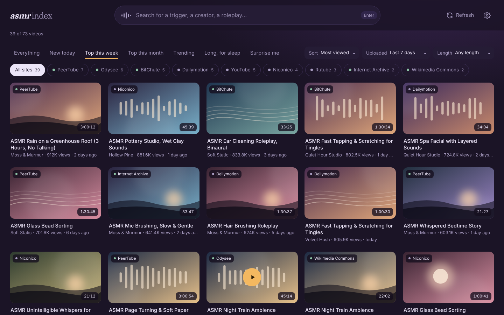
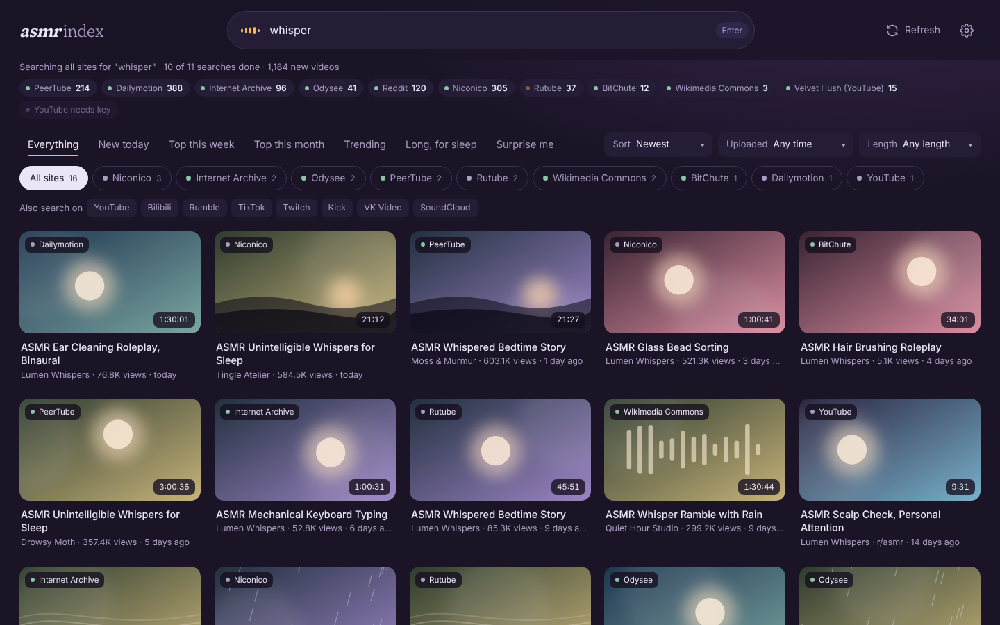
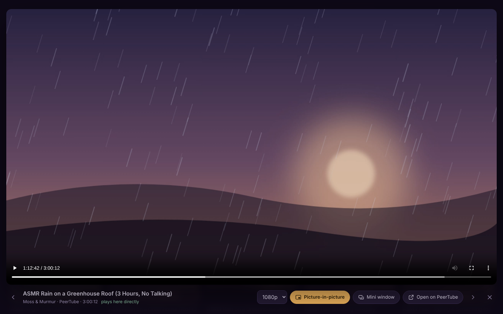
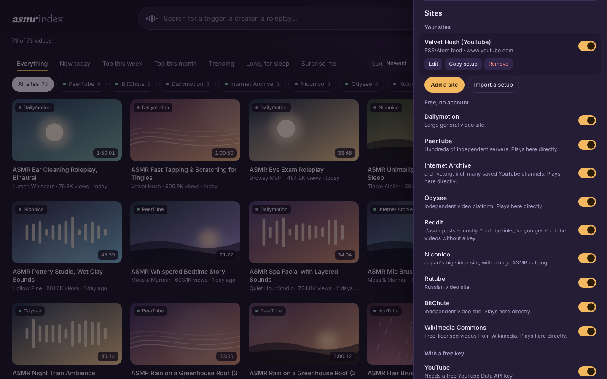
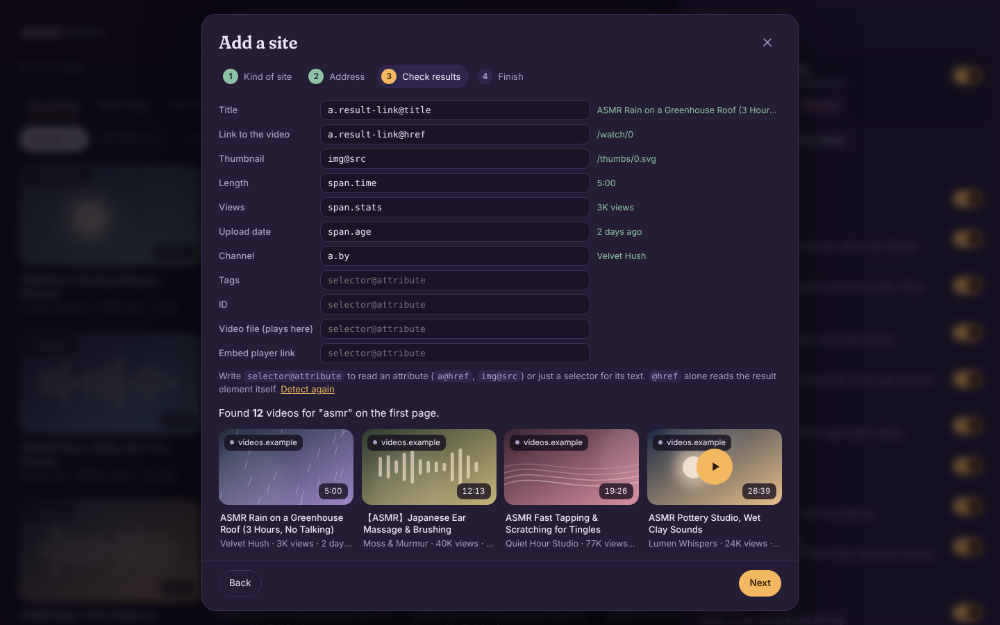

  

<h1 align="center">ASMR Index</h1>

  Search ASMR videos across many video sites at once, keep them in one archive, 
  and watch them in a calm built-in player – without visiting sketchy sites.

  <a href="../../releases/latest"><b>Download the latest release</b></a> ·
  <a href="#install">Install</a> ·
  <a href="#sites">Sites</a> ·
  <a href="#add-your-own-sites">Add your own sites</a> ·
  <a href="#privacy--permissions">Privacy</a>

  

> **Project status:** finished and working (October 2026), but no longer actively developed.
> Video sites change their APIs from time to time; when one breaks, its chip turns red and the
> other sites keep working. Fixes, forks and pull requests are very welcome – see
> [CONTRIBUTING.md](CONTRIBUTING.md). If you'd like to take over maintenance, open an issue.

ASMR Index is a Chrome extension (it should also work in Edge, Brave, Opera and other Chromium browsers).
It runs entirely in your browser: there is no server, no account and no tracking.

## Features

- **One search, many sites.** Type what you're in the mood for – *ear cleaning*, *rain*, *page turning* –
  and it searches up to 12 video sites at once (plus 5 adult sites if you switch them on).
- **ASMR only.** Results are kept only if "ASMR" is in the title or tags, so a search for *tapping*
  doesn't fill up with drum lessons.
- **A growing archive.** Everything found is saved in your browser and refreshed once a day.
  Tens of thousands of videos stay fast.
- **Quick views and filters.** New today · Top this week · Top this month · Trending · Long, for sleep ·
  Surprise me – or combine sort, upload date and length yourself, and filter by site.
- **Built-in player.** Many videos play as plain video files right in the extension, with no web page,
  ads or scripts from the source site. Others use the site's official player in a sandboxed frame that
  can't open pop-ups or redirect you.
- **Picture-in-picture everywhere.** Pop any video out – in the player, on embedded players, and on any
  website (right-click → *Picture-in-picture*, or <kbd>Alt</kbd>+<kbd>Shift</kbd>+<kbd>P</kbd>).
- **Add your own sites.** A wizard turns a YouTube channel, a PeerTube server, an RSS feed, a JSON API or
  even a plain website search page into a source that works like the built-in ones.
- **Optional 18+ section,** off by default, behind an age confirmation – also ASMR-only.

## Screenshots

| Search across sites | Player with picture-in-picture |
|---|---|
|  |  |

| Settings | Add a site wizard |
|---|---|
|  |  |

## Install

ASMR Index isn't in the Chrome Web Store, so you install it as an "unpacked" extension. It takes a minute:

1. **Download** `asmr-index-x.y.z.zip` from the [latest release](../../releases/latest) and unzip it.
   You get a folder called `asmr-index`. Keep it somewhere permanent – Chrome loads the extension from it.
2. Open **`chrome://extensions`** and switch on **Developer mode** (top right).
3. Click **Load unpacked** and select the `asmr-index` folder.
4. Pin **ASMR Index** via the puzzle-piece icon in the toolbar, then click it.

The first start searches every site to build your archive. This takes a few minutes; videos appear as they
arrive and you can browse meanwhile.

**Updating:** replace the folder's contents with the new version and click the reload arrow on the
extension at `chrome://extensions`. Your archive and settings are kept.

**From source:** clone this repository and load the `extension` folder the same way. There is no build step.

## Using it

- **Search:** your archive filters as you type. After a second (or on <kbd>Enter</kbd>) every enabled site
  is searched live for "asmr + your words". Press <kbd>Enter</kbd> again – or the button at the end of the
  results – to search much deeper.
- **Refresh** searches every site for each term under *Settings → Archive searches* (12 common ASMR
  searches by default). It also runs by itself once a day.
- **Quick views:** *Top this week* means the most-viewed videos uploaded in the last 7 days – sites only
  report total views, not views per week. *Trending* ranks by views per day since upload.
- **Sites row:** the pills under the filters show how many videos each site has for the current view;
  click one to see only that site.
- **Also search on…** buttons open your search on sites that have no public API (Bilibili, Rumble,
  TikTok, …) in a new tab.
- Click a video to play it. <kbd>Ctrl</kbd>/<kbd>Cmd</kbd>-click or middle-click opens it on its own site.
- Keys: <kbd>/</kbd> search · <kbd>Esc</kbd> close · <kbd>←</kbd> <kbd>→</kbd> previous / next ·
  <kbd>Alt</kbd>+<kbd>P</kbd> picture-in-picture.

## Sites

Every site can be switched off in *Settings → Sites*. Switching one off hides its videos immediately;
switching it back on brings them back.

| Site | Needs | Plays in the app | Notes |
|---|---|---|---|
| Dailymotion | – | site's player | |
| PeerTube | – | **direct file** | Hundreds of independent servers, via Sepia Search |
| Internet Archive | – | **direct file** | Includes many archived YouTube channels |
| Odysee | – | **direct file** | |
| Reddit r/asmr | – | YouTube player / **direct** | Mostly YouTube links, so you get YouTube videos without a key |
| Niconico | – | site's player | Large Japanese ASMR catalog |
| Rutube | – | site's player | |
| BitChute | – | **direct file** | |
| Wikimedia Commons | – | **direct file** | Free-licensed videos |
| YouTube | free API key | YouTube's player | Uses `youtube-nocookie.com` |
| Vimeo | free access token | Vimeo's player | |
| Twitch | free client ID + secret | Twitch's player | Past broadcasts from the ASMR category |

**18+** (only after you switch on *18+ content* and confirm your age; Chrome then asks once for access):
Eporner, RedGifs (direct files), RedTube, Pornhub, YouPorn and Reddit r/NSFWASMR. The ASMR-only rule
applies here too.

<b>Getting the free keys</b>

- **YouTube:** in the [Google Cloud console](https://console.cloud.google.com/) create a project,
  enable *YouTube Data API v3*, then *Credentials → Create credentials → API key*. The free quota covers a
  daily refresh plus about 50 live searches. Tip: restrict the key to the YouTube Data API.
- **Vimeo:** at [developer.vimeo.com](https://developer.vimeo.com/) create an app, then generate a
  personal access token with the *public* scope.
- **Twitch:** at [dev.twitch.tv/console](https://dev.twitch.tv/console) register an application
  (any name, OAuth redirect `http://localhost`, client type *Confidential*), copy the client ID and create a client secret.

Paste them in *Settings → Sites* under the matching site. They're stored only in your browser.

## Add your own sites

*Settings → Sites → **Add a site*** opens a four-step wizard:

1. **Pick the kind of site**
   - **YouTube channel** – paste the channel link or @handle. Uses the channel's public feed: no key needed,
     but only the newest 15 videos.
   - **PeerTube server** – just its address, e.g. `tilvids.com`.
   - **RSS or Atom feed** – e.g. `vimeo.com/USER/videos/rss` or `odysee.com/$/rss/@CHANNEL`.
   - **JSON search API** – an address with `{q}` for the search words and `{page}`, `{page0}` or `{offset}`
     for the page number.
   - **Website search page** – search on the site, paste the address of the results page and the words you
     searched; they become `{q}`.
2. **Try it** – Chrome asks once for access to that site, then a real test search runs.
3. **Check results** – the list and fields (title, link, thumbnail, length, views, date, channel, video file)
   are detected automatically. Each shows a sample value and the preview updates as you edit.
4. **Finish** – name it, mark it as "everything here is ASMR" or 18+, optionally set up an embed player, and
   it's searched right away.

Your sites get their own switch, chip and filter pill, and take part in Refresh and live search. Use
**Copy setup** to share one as text and **Import a setup** to add one someone shared (API keys in extra
headers are never included).

Limits: pages that build their results with JavaScript after loading can't be read this way (the wizard
says so) – look for a feed or an API instead. Reading a site's pages may be against its terms; check before
you add it.

## Picture-in-picture

- **In the player:** *Picture-in-picture* or <kbd>Alt</kbd>+<kbd>P</kbd>. While it's popped out you can
  close the player and keep browsing; a small bar lets you bring it back or stop it.
- **Embedded players** (YouTube, Dailymotion, …): hover the video and click *Pop out* in its corner.
- **Mini window:** puts the whole player into a small always-on-top window (Chrome 116+).
- **On any website:** right-click → *Picture-in-picture*, or <kbd>Alt</kbd>+<kbd>Shift</kbd>+<kbd>P</kbd>
  (change it at `chrome://extensions/shortcuts`). *Settings → Pop-out button on every website* adds the
  hover button everywhere.

## Privacy & permissions

- **No server, no account, no analytics.** The extension talks directly to the sites you enable.
- **Everything stays in your browser:** the archive (IndexedDB), settings, filters and any API keys
  (`chrome.storage.local`). *Settings → Archive → Clear archive* deletes the archive.
- Searches are sent **without your cookies**, and thumbnails load without a referrer.
- Videos marked as direct files are played from the file itself – no page, script or tracker from the site.
  Embedded players are the sites' own and follow their privacy rules; switch on
  *Only videos that play here directly* to avoid them entirely.

| Permission | Why |
|---|---|
| `storage`, `unlimitedStorage` | Save settings and a large video archive locally |
| Access to the sites' API addresses | Run the searches |
| `scripting`, `activeTab`, `contextMenus` | Picture-in-picture via right-click and keyboard shortcut |
| Runs on YouTube, Dailymotion, Vimeo, Odysee, Niconico, Twitch, Rutube and BitChute pages | Adds the *Pop out* button to their (embedded) players |
| Optional: adult sites | Only requested when you switch on 18+ content |
| Optional: other sites | Requested one site at a time for sites you add with the wizard, or for all sites if you switch on the pop-out button everywhere |

## Content & safety

- 18+ sources are off by default and need an explicit switch plus an age confirmation.
- Videos whose titles describe "leaked" private videos are always filtered out, since these are often
  shared without consent.
- ASMR Index only shows what the sites' own search returns. It isn't affiliated with any of them, and
  each site's terms of use apply.

## Troubleshooting

- **A site's chip is red:** hover it to see the error. Usually the site changed its API or is down; the
  other sites keep working. Please [open an issue](../../issues/new/choose) or fix the adapter in
  `extension/sources.js`.
- **"Needs key" chips:** fill in the key under *Settings → Sites*, or switch that site off.
- **A video won't play inside the app:** use *Open on …* in the player.
- **Something else:** right-click inside the ASMR Index tab → *Inspect* → *Console* shows details.

**Why isn't it in the Chrome Web Store?** It needs broad access to many sites, includes optional adult
sources and can read website search pages – none of which fit the store's review well. Installing it
unpacked lets you see exactly what runs.

## Contributing

There's no build step and no dependencies – plain JavaScript, HTML and CSS. [CONTRIBUTING.md](CONTRIBUTING.md)
explains how the code is organised, how to add or fix a site, and how to make a release.
Changes are listed in [CHANGELOG.md](CHANGELOG.md).

## License

[MIT](LICENSE) for ASMR Index itself. Bundled third-party files keep their own licenses:

- [hls.js](https://github.com/video-dev/hls.js) 1.5.20 – Apache License 2.0 ([text](licenses/hls.js-Apache-2.0.txt))
- [Fraunces](https://github.com/undercasetype/Fraunces) by Undercase Type – SIL Open Font License 1.1 ([text](licenses/Fraunces-OFL-1.1.txt))

All site names are trademarks of their owners and are used only to describe what the extension connects to.
